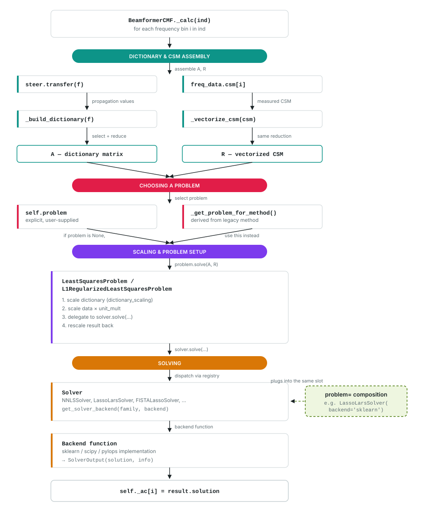

.. _microphone_array_methods:

Microphone Array Methods
=========================

Covariance Matrix Fitting (CMF) is an inverse method for estimating
acoustic source strengths from microphone array measurements
:cite:`Yardibi2008`. Unlike conventional delay-and-sum beamforming,
which evaluates each focus point independently by steering and
summing microphone signals, CMF fits a modeled cross-spectral
matrix (CSM) to the measured CSM to estimate the source strengths
that best explain the measurements across the array.

This formulation turns source localization into a least-squares
fitting problem. :class:`~acoular.fbeamform.BeamformerCMF` provides
several built-in solvers, including methods that constrain source
strengths to be non-negative and methods that promote sparse
solutions. The solver architecture described below also allows
users to add custom solvers.

Model
-----

At a given frequency, each microphone measures a mix of contributions from
every candidate source location on the focus grid, with each contribution
attenuated and phase-shifted according to the distance it traveled. Averaged
over many short time blocks, this yields a measured cross-spectral matrix
(CSM) describing the correlations between every pair of microphones.

CMF compares this measured CSM against a modeled one, built from the known
propagation paths between each focus-grid point and each microphone, weighted
by an unknown source-strength vector: one value per grid point. Finding the
source strengths that make the modeled CSM best match the measured one is a
least-squares fitting problem. See :cite:`Yardibi2008` for the full
derivation.

In Acoular, the propagation values in this dictionary come from
:attr:`~acoular.fbeamform.BeamformerCMF.steer`
(:class:`~acoular.fbeamform.SteeringVector`). The measured CSM values come
from :attr:`~acoular.fbeamform.BeamformerCMF.freq_data`
(:class:`~acoular.spectra.PowerSpectra`). Both are reduced to the same
non-redundant set of upper-triangular CSM entries, so the dictionary and the
measured data have consistent shapes.

   One frequency bin's path through ``_calc``: ``steer`` and ``freq_data``
   are reduced to a dictionary matrix and a vectorized CSM; either an
   explicit ``problem`` or one derived from the legacy ``method`` trait is
   selected; the ``Problem`` scales both inputs and delegates to its
   ``Solver``, which dispatches through the backend registry to a concrete
   implementation. That is the same slot your own ``problem=``/``solver=``
   composition plugs into.

Example
-------

:class:`~acoular.fbeamform.BeamformerCMF` is used like any other frequency-domain
beamformer: a sensor geometry, a focus grid, a steering vector, and a source
of cross-spectral data are set up, then passed in along with the chosen
method:

.. literalinclude:: ../../examples/wind_tunnel_examples/example_airfoil_in_open_jet_cmf.py
   :language: python
   :lines: 38-50

See :doc:`../auto_examples/wind_tunnel_examples/example_airfoil_in_open_jet_cmf`
for a complete, runnable example comparing several of the built-in methods on
measured array data.

Built-in Methods
-----------------

.. list-table::
   :header-rows: 1
   :widths: 15 20 15 50

   * - ``method``
     - Solver class
     - Non-negative
     - Sparsity mechanism
   * - ``'NNLS'``
     - :class:`~acoular.solvers.NNLSSolver`
     - Yes
     - None
   * - ``'LassoLars'``
     - :class:`~acoular.solvers.LassoLarsSolver`
     - Yes
     - L1 penalty, strength set via :attr:`~acoular.fbeamform.BeamformerCMF.alpha`
   * - ``'LassoLarsBIC'``
     - :class:`~acoular.solvers.LassoLarsBICSolver`
     - Yes
     - L1 penalty, strength selected automatically via BIC
   * - ``'OMPCV'``
     - :class:`~acoular.solvers.OMPCVSolver`
     - No
     - Greedy selection (Orthogonal Matching Pursuit), not an L1 penalty
   * - ``'fmin_l_bfgs_b'``
     - :class:`~acoular.solvers.LBFGSBSolver`
     - Yes
     - None
   * - ``'FISTA'``
     - :class:`~acoular.solvers.FISTALassoSolver`
     - No
     - L1 penalty, strength set via :attr:`~acoular.fbeamform.BeamformerCMF.alpha`
   * - ``'Split_Bregman'``
     - :class:`~acoular.solvers.SplitBregmanLassoSolver`
     - No
     - L1 penalty, strength set via :attr:`~acoular.fbeamform.BeamformerCMF.alpha`

Custom Solvers
--------------

:class:`~acoular.fbeamform.BeamformerCMF` can also be configured with an
explicit problem/solver composition, rather than selecting a built-in
``method``:

Setting the ``problem`` attribute to an instance of
:class:`~acoular.solvers.LeastSquaresProblem` or
:class:`~acoular.solvers.L1RegularizedLeastSquaresProblem` overrides the
``method`` trait entirely. The problem instance takes a ``solver`` (any of
the classes listed in the table above, or a custom one), plus the same
options available on ``BeamformerCMF`` itself: ``alpha``, ``nonnegative``,
and ``dictionary_scaling``. Most built-in solvers also accept a ``backend``
keyword to select which library implementation is used, for example
``LassoLarsSolver(backend='sklearn')``.

Writing a New Solver
---------------------

A solver only needs to subclass :class:`~acoular.solvers.LeastSquaresSolver`
and implement :meth:`~acoular.solvers.SolverBase.solve` with the signature
``solve(self, problem, dictionary_matrix, data, start_value=None)``,
returning a :class:`~acoular.solvers.SolverOutput`. The resulting solver is
attached the same way the built-in solvers are, via the ``solver`` argument
of :class:`~acoular.solvers.LeastSquaresProblem` or
:class:`~acoular.solvers.L1RegularizedLeastSquaresProblem`.

``solve`` receives the already-scaled dictionary matrix and data for one
frequency bin. Scaling is handled by the attached
:class:`~acoular.solvers.LeastSquaresProblem` or
:class:`~acoular.solvers.L1RegularizedLeastSquaresProblem`, not by the
solver itself. It must return the solved source strengths in
:attr:`~acoular.solvers.SolverOutput.solution`; any backend-specific
diagnostics can be returned via :attr:`~acoular.solvers.SolverOutput.info`.

For a solver that should support multiple interchangeable backends the way
the built-in solvers do, subclass :class:`~acoular.solvers.BackendDispatchSolver`
instead and register one or more backend functions via
:func:`~acoular.solvers.register_solver_backend`.

